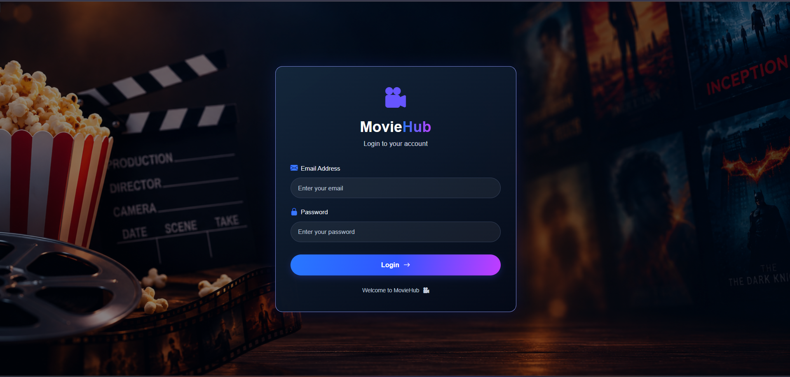
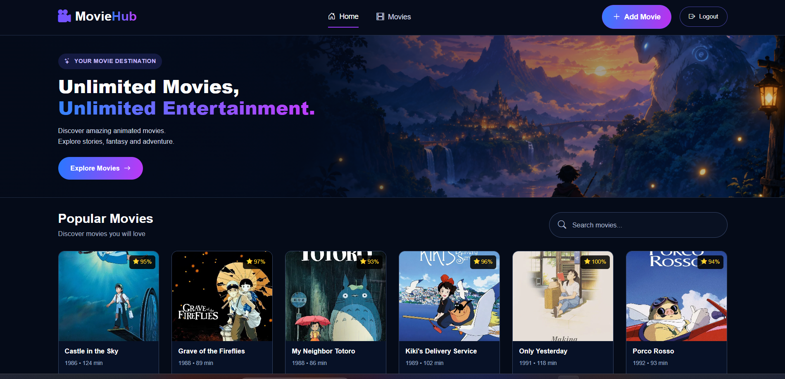
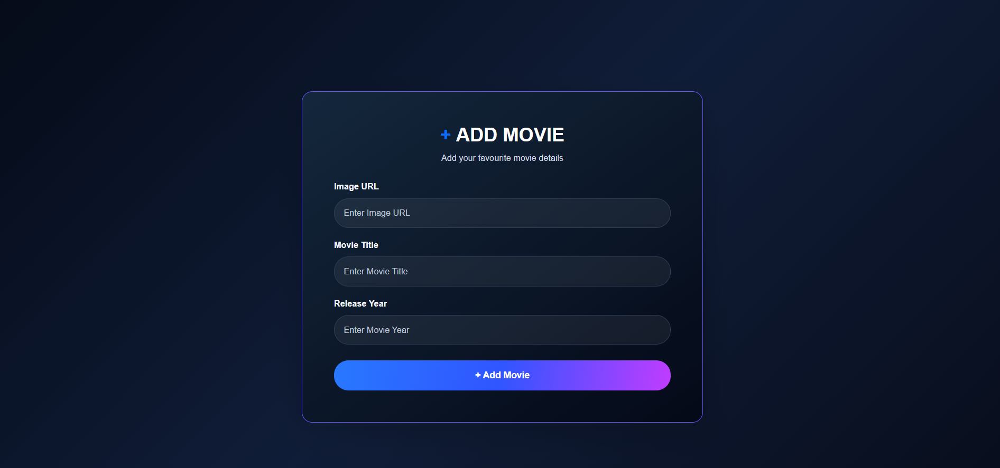

# 🎬 Movie Library

## 📌 About Project

Movie Library is a React-based web application that allows users to explore movies and view movie details. It provides a simple and user-friendly interface with movie banners and navigation.

## ✨ Features

- User Login Page
- Browse Movies
- View Movie Details
- Movie Banner and Background Images
- React Router for Navigation
- Redux for State Management
- Responsive Design

## 🛠️ Technologies Used

- React.js
- JavaScript
- Bootstrap
- React Router DOM
- Redux
- React Redux
- CSS
- Movie API

## 📂 Project Structure

Movie-Library/
- public/
- src/
   - assets/
   - components/
   - pages/
    - Login.jsx
  - Redux/
    - store.js
    - reducer.js
   - App.jsx
   - main.jsx
- package.json
- README.md

## 📱 Responsive Design

The application uses Bootstrap to provide a responsive and user-friendly interface across different screen sizes.

## 🖼️ Images

### Login Page

###  Movie Page

### Form Page
"# MovieApp" 
